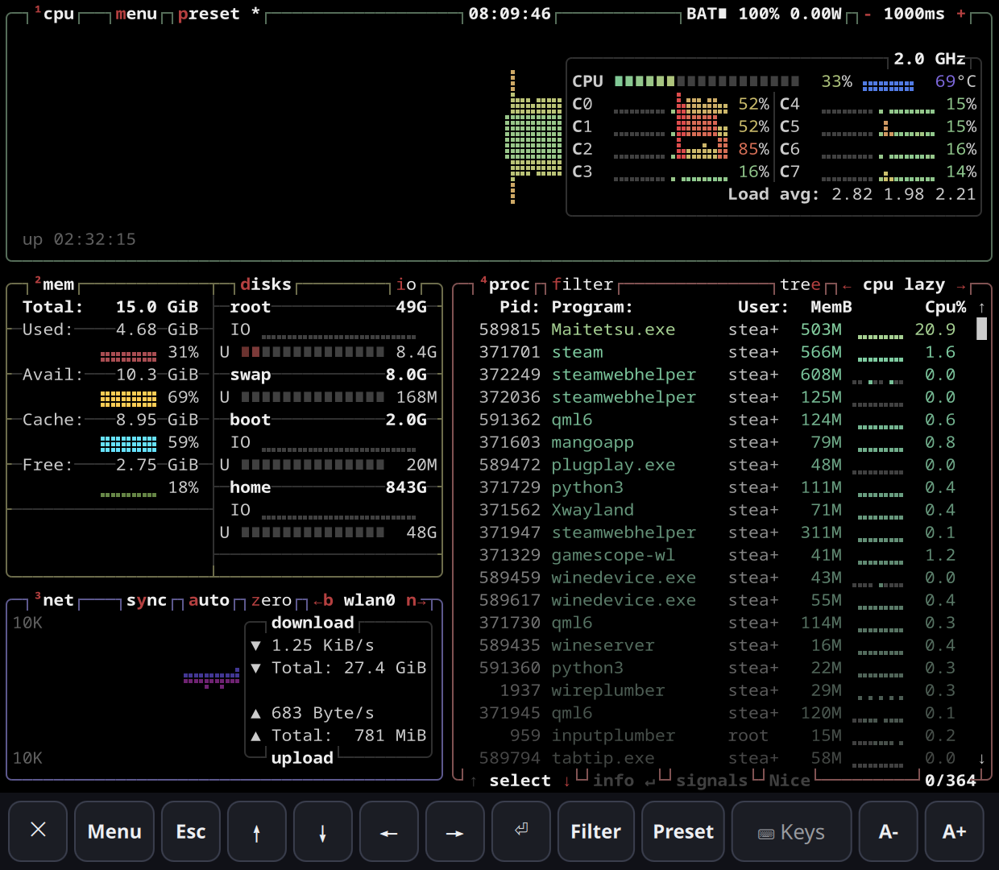

# btop for Barry Launcher

> [!IMPORTANT]
> **This repo was built with a coding agent: [Claude Code](https://www.anthropic.com/claude-code),
> running Anthropic's Claude Opus 5.5 (`claude-opus-5-5`).** Claude wrote the
> code and this README. A person set the goals and made the decisions; Claude
> tested it on a PC and on an AYN Thor over SSH. Review the code before you
> rely on it.

> [!TIP]
> **Join the Project Barry community on Discord:** https://discord.gg/euPurKCWc4
>
> **Watch Project Barry on YouTube:** https://www.youtube.com/@Project-Barry

[btop](https://github.com/aristocratos/btop) on the AYN Thor's bottom screen,
as a [Barry Launcher](https://github.com/project-barry/barry-launcher) app.
It shows CPU, memory, disks, network and processes while a game runs on the
top screen.



## What it does

- **btop, full screen**, sized to fit the bottom screen, refreshed once a
  second.
- **Touch:** a tap is a mouse click where btop draws it: box titles, menu
  items, processes, buttons. A drag up or down scrolls, for example in the
  process list.
- **A bar of keys** for btop's main ones: Menu, Esc, the arrows, Enter,
  Filter and Preset. The **Keys** field brings up the on-screen keyboard for
  the rest; **A−** and **A+** set the text size, which it keeps.
- **A hardware keyboard** works too.
- **Closing:** ✕ closes the app, and so does quitting btop (`q`, or Quit in
  its menu).
- **Brings its own btop**, if you build it that way: SteamOS has none, and
  its `/usr` is read-only. See [Build](#build).

## Requirements

- Barry Launcher, from [pb-os](https://github.com/project-barry/pb-os) Thor
  images or [installed yourself](https://github.com/project-barry/barry-launcher)
- btop: the one in the package (see [Build](#build)), or the system's

## Install

Get a package (see [Build](#build)) onto the device, then, as the user who
plays in Game Mode:

```sh
barry-app install btop-1.0.0-with-btop-1.4.7-aarch64.zip
```

It's on the home screen right away. The Barry Launcher Decky plugin's
**Install app…** works too. The app comes with a service (see
[How it works](#how-it-works)), so both say so before installing.

To update, install a newer package the same way. It replaces the app and
keeps its settings.

## Uninstall

```sh
barry-app remove io.github.melanpan.btop
```

This also deletes btop's settings, the app's text size and its log. To keep
them, add `--keep-data`. The ✕ next to btop in the Decky plugin's app list
removes it too.

## Build

```sh
./package.sh --with-btop          # aarch64 (AYN Thor): dist/btop-1.0.0-with-btop-1.4.7-aarch64.zip
./package.sh --with-btop=x86_64   # for an x86_64 device
./package.sh                      # the app alone, for systems that have btop
```

`--with-btop` downloads btop's static build from its
[releases](https://github.com/aristocratos/btop/releases) and puts it in
`bin/`. `BTOP_VERSION=1.4.6 ./package.sh --with-btop` picks another release.
The script needs `curl`, plus `zip` or Python 3.

To try it on a Linux PC (needs Qt 6's `qml` tool):

```sh
barry-app run .
```

## How it works

QML has no terminal, so the app comes with a service (`service.py`, Python 3
standard library only). Barry Launcher starts it with the app and stops it
when the app closes.

1. The service runs btop in a pseudo-terminal, at the size that fits the
   screen.
2. A small xterm emulator in the service keeps btop's screen as cells. It
   handles truecolour, 256 colours, the alternate screen, scroll regions and
   mouse modes.
3. `main.qml` long-polls `/screen` for the rows that changed and draws them
   on a Canvas. Box lines, block characters and braille (btop's graphs) are
   drawn as shapes. That way they join up with no gaps and look the same
   whatever fonts the device has. Text that a fallback font draws wider or
   narrower is squeezed to fit its cells.
4. While you only watch, it draws at most once a second. For a few seconds
   after a tap or a key, it draws every change at once, so menus and
   scrolling keep up.
5. Taps and drags go back to btop as xterm mouse events, and keys as the
   bytes a terminal sends.

btop's settings are kept in the app's data folder:
`~/.local/share/barry_launcher/app-data/io.github.melanpan.btop/.config/btop`.
On the first start they're copied from [`btop.conf`](btop.conf) (an update
every second, rounded corners, braille graphs). After that, change them in
btop's options menu (`o`).

The service uses `bin/btop` from the app's folder if there is one, else the
system's `btop`. Archives install without file modes, so it copies the
bundled btop into the data folder and marks it executable there.

| File | What it is |
|---|---|
| `barry-app.json` | the manifest |
| `main.qml` | the screen, touch and keys |
| `service.py` | btop in a pseudo-terminal, the terminal emulator, the HTTP API |
| `btop.conf` | btop's first settings |
| `icon.svg` | the home-screen tile |
| `package.sh` | builds the package |

## License and credits

- **btop** is by Jakob P. Liljenberg (aristocratos), under Apache-2.0:
  [aristocratos/btop](https://github.com/aristocratos/btop). Packages built
  with `--with-btop` include it and carry its license as `bin/btop-LICENSE`.
- **Barry Launcher** and its app format are by lavachemist for
  [project-barry](https://github.com/project-barry).

Written with Claude Code (Anthropic, model Claude Opus 5.5).
